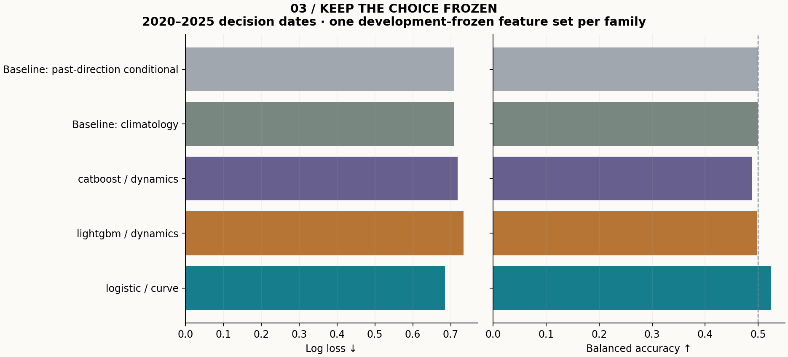

# Financial ML Validation

Can yield-curve features improve a 20-session forecast of the direction of the 10-year U.S. Treasury reference yield? I compare logistic regression, LightGBM and CatBoost with simple probability baselines using 9,005 public Federal Reserve H.15 observations from 1990–2025.

**Finding.** The training-frequency baseline led development. On 1,479 historical confirmation decisions in 2020–2025, the development-selected CatBoost classifier recorded log loss of **0.71866**, versus **0.70915** for the baseline. The paired gain was **−0.00951** (positive favors CatBoost), with a 63-session block 95% interval of **[−0.01688, −0.00297]**.

[Full results](reports/real/REPORT.md) · [Methods](docs/METHODS.md) · [Run the study](#run-the-study)



*Historical H.15 confirmation, 2020–2025. Lower log loss and Brier score indicate better probability forecasts. The frozen selection and results for all five comparators are in the [report](reports/real/REPORT.md).*

## How the comparison was designed

- **Information timing.** Trailing features observed on session t get a full intervening session for assumed publication. The decision is at 09:00 New York time on t+2. The label begins with the later yield measurement that day and ends 20 observed sessions later.
- **Training and selection.** Expanding folds remove labels unavailable at each decision. Preprocessing fits within training. Nine fixed classifier configurations and two train-fitted baselines share the comparison, with model choices frozen before confirmation.
- **Uncertainty.** Overlapping targets create dependence. Paired moving-block intervals use 63 and 126 sessions. CatBoost's accuracy difference spans zero, and a favorable logistic log-loss point estimate is sensitive to block length. [Clock walkthrough](docs/WALKTHROUGH.md) · [Paired uncertainty](reports/real/uncertainty.png) · [Validation](docs/VALIDATION.md)

The H.15 snapshot is a current historical vintage. Exact historical releases and revisions are unavailable, so the publication lag is an explicit assumption. The target is a change in a reference yield. The experiment has no bond P&L or modeled execution.

## Equity extension

The separate equity workflow implements historical month-end membership, eight lagged price and liquidity features, origin-beta residuals, WLS and weighted regularization, and annual outer evaluation. The public **synthetic fixture** exercises selection, training-only transforms and costed quintile diagnostics. Licensed CRSP inputs and restricted results are held privately.

[Equity methods](docs/EQUITY_RESEARCH.md) · [Synthetic fixture results](reports/equity-fixture/REPORT.md) · [Temporal tests](tests/test_equity.py)

## Run the study

Use Python 3.12 from the repository root. Activate the virtual environment with `.venv\Scripts\Activate.ps1` in PowerShell or `source .venv/bin/activate` on macOS/Linux.

```bash
python -m venv .venv
# Activate the environment before installing.
python -m pip install -r requirements.lock.txt pyarrow==26.0.0
python -m pip install --no-deps -e .
python -m pip check
python -m pytest -q tests
python -m ml_validation --real --output local-runs/real
```

The Treasury run uses bundled observations and runs offline after installation. Use a fresh output directory for repeat runs. The report links the source, protocol, predictions and timing audit. The [earlier synthetic study](reports/demo/REPORT.md) documents the separate alignment demo and anonymous-challenge adapter.

[Data license](DATA_LICENSE.md) · [Attribution and AI assistance](docs/PROVENANCE.md) · [Technical discussion](docs/DISCUSSION.md) · [Research directory](https://github.com/Mingju-Zhang-CBS/Quant)
