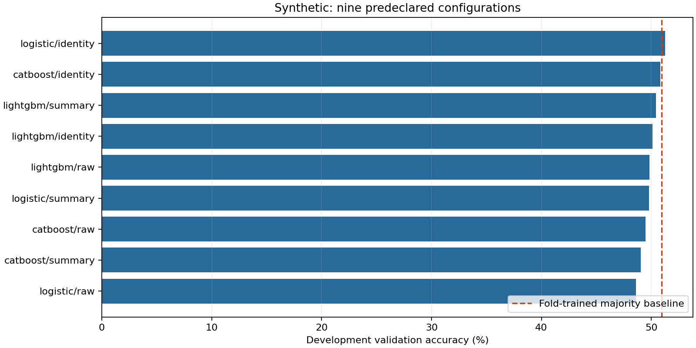
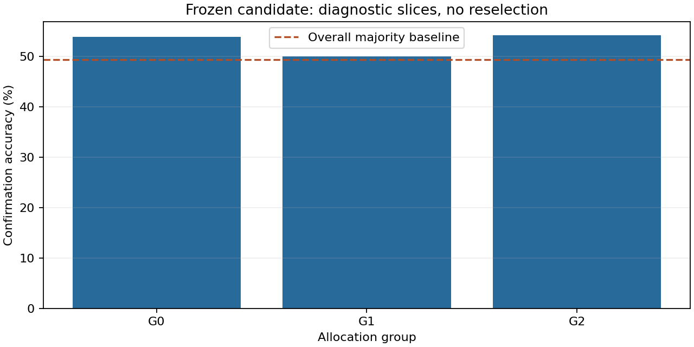

# Financial classification and validation

Data: **synthetic**. This simulated panel is not the official QRT dataset and provides no evidence of market predictability or leaderboard performance.

Protocol: known synthetic chronology; 20-date purge. Development: 268 dates / 3216 rows. Confirmation: 72 dates / 864 rows.

|Configuration|Development accuracy|Balanced accuracy|Fit seconds across folds|
|---|---:|---:|---:|
|logistic/identity|51.244%|51.161%|0.058|
|catboost/identity|50.829%|50.647%|1.155|
|lightgbm/summary|50.415%|50.306%|0.192|
|lightgbm/identity|50.124%|50.017%|0.196|
|lightgbm/raw|49.834%|49.726%|0.129|
|logistic/summary|49.793%|49.720%|0.054|
|catboost/raw|49.461%|49.260%|1.262|
|catboost/summary|49.046%|48.863%|1.243|
|logistic/raw|48.590%|48.512%|0.027|

The frozen choice was **logistic/identity**, selected solely on development accuracy with threshold 0.50. Confirmation accuracy: **52.662%**; fold-independent confirmation majority baseline: **49.306%**. Paired accuracy difference: **3.356 percentage points**, with a date-cluster bootstrap 95% interval **[-2.083, 9.028]**. A negative or uncertain difference is retained, not tuned away.

## What is controlled

Labels join by ROW_ID; input order is irrelevant. Each preprocessing pipeline fits only its training rows. Dates, row IDs and targets are excluded from all features. The three fixed ablations use raw histories, summary statistics and optionally allocation identity. All nine configurations use the same development folds. No neural model, hyperparameter search, threshold search or public leaderboard feedback is used.

## Limits

Synthetic dates have a known generating order: forward development folds and confirmation are separated by 20 dates to isolate the 20-observation history. Official TS labels are anonymized and shuffled: the user-data protocol uses whole-date groups with a stable hash split, which does not establish true forward performance or remove unknown history overlap. Previously exposed official labels remain exposed even after a new split. Date bootstrap accounts for within-date dependence, not arbitrary dependence across dates. Confidence intervals are descriptive following development selection. Accuracy on a sign label is not a trading return, Sharpe or execution claim. This run does not upload predictions or measure public/private challenge scores.

`manifest.json` binds source, input fingerprint, configuration and environment. `metrics.json` includes timing and sampled process RSS; the freeze is recorded in `frozen_selection.json`.
