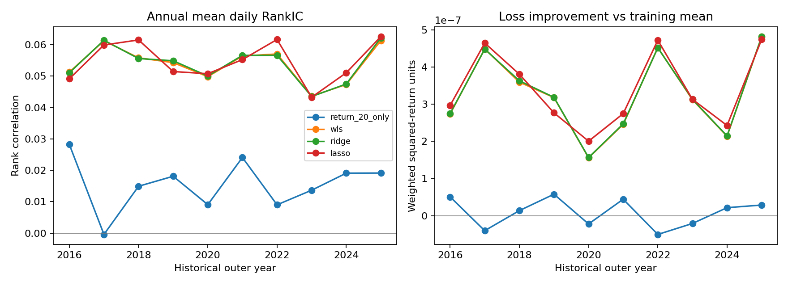
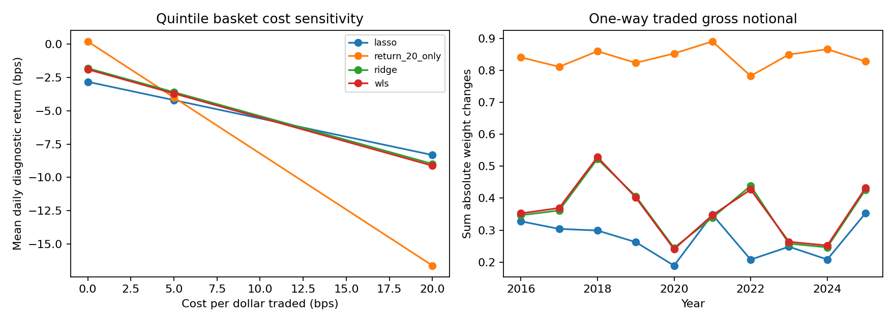

# Transparent equity research — executed synthetic fixture

62,568 feature-valid prediction rows; 62,568 evaluable labels; 2,607 decision sessions. These counts describe this run and do not establish independent observations or alpha. A synthetic fixture demonstrates behavior only.

## Read the evidence

The annual file retains every model and outer year. Inner selection uses five expanding windows inside the preceding four years; its validation scores are not outer-test scores. Both training and validation use fitted training-only clipping, scaling and inverse-variance weight caps. Selection is purged by label availability. The standardized-target sensitivity uses equal weights, separately from the main raw-residual target.

`daily_metrics.csv` contains IC, RankIC and weighted loss improvements; `inference.csv` reports fixed 20- and 63-session block intervals. Constant baselines have undefined IC, not artificial zero IC. `feature_family.csv` retains all eight hypotheses, including failures; Bonferroni controls familywise error with valid marginal tests, while BH requires independence or suitable positive dependence for its usual FDR interpretation. HAC p-values remain an asymptotic approximation.

## Financial meaning

Stocks are sorted before observing outcomes. Missing realized returns invalidate that basket's outcome rather than becoming zeros or changing its membership. Long and short legs each have unit gross weight; costs use the full sum of absolute weight changes at 0/5/20 bps. This is a diagnostic: no borrow availability, financing, volume participation or executable NAV is established. Raw stock returns, origin-beta residuals and cross-sectional prediction slopes have different units and must not be conflated.

## Information contract and limitations

Observation t close precedes decision t+1 morning and implementation t+1 close. The return runs to t+2 close and is assumed available t+3 morning. Reindexed calendar joins prevent a missing session from becoming a next-observed-row target. The 252-session factor fit ends t-1; its coefficients are held fixed when constructing the future residual. No future volatility normalizes a target. Factor returns are used for ex-post attribution; the current factor vintage and assumed release allowance do not establish historical point-in-time factor availability. CIZ total returns already include their income/delisting conventions; no second dividend or delisting return is added.

Raw records, security predictions and contractually restricted derived data stay private. Publication requires the applicable vendor rights assessment; a fixture report cannot substitute for a real-data result. Source, protocol and output hashes are recorded in `manifest.json`.
