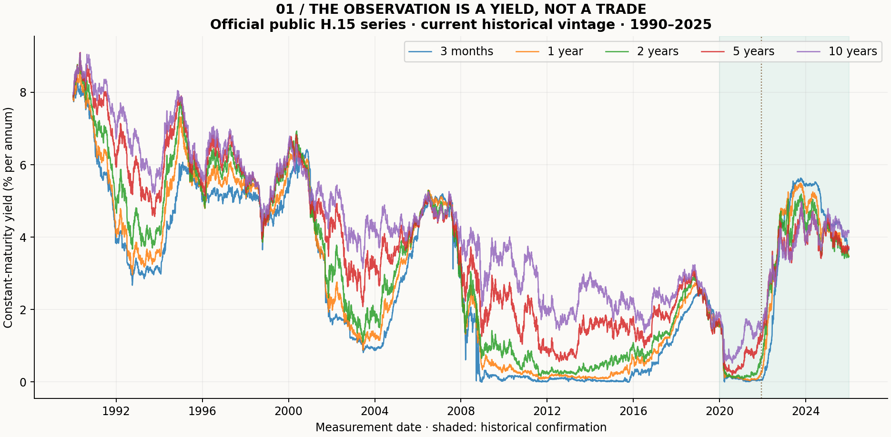
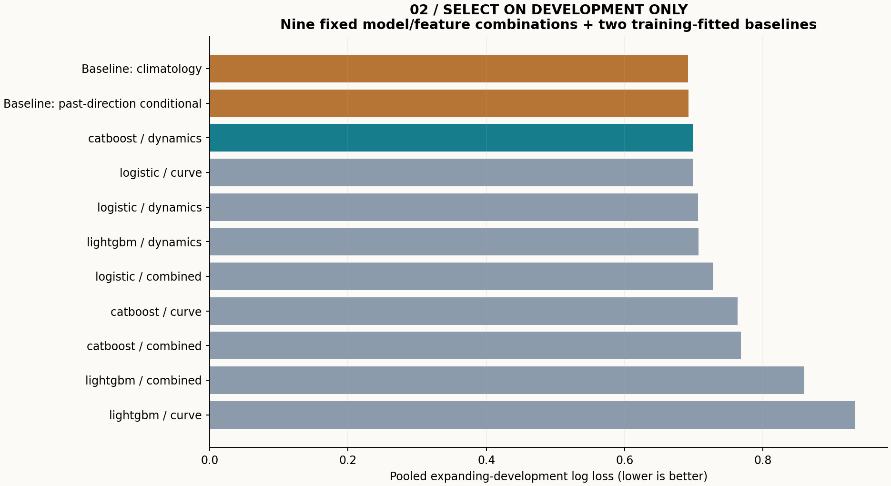
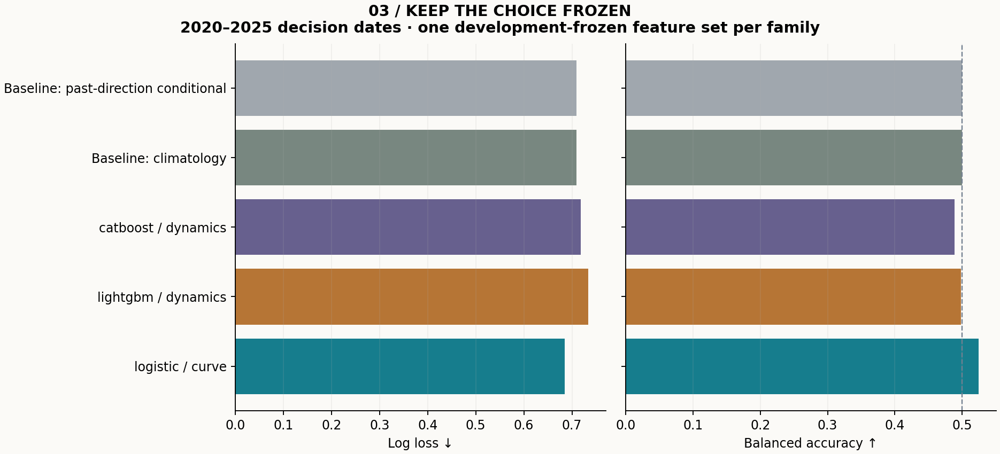
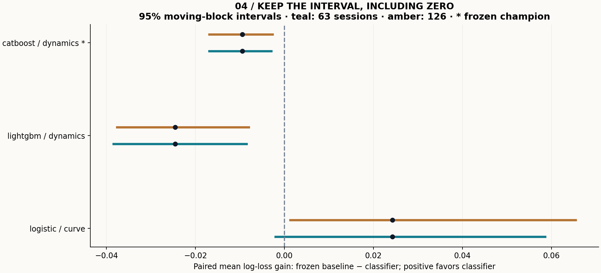
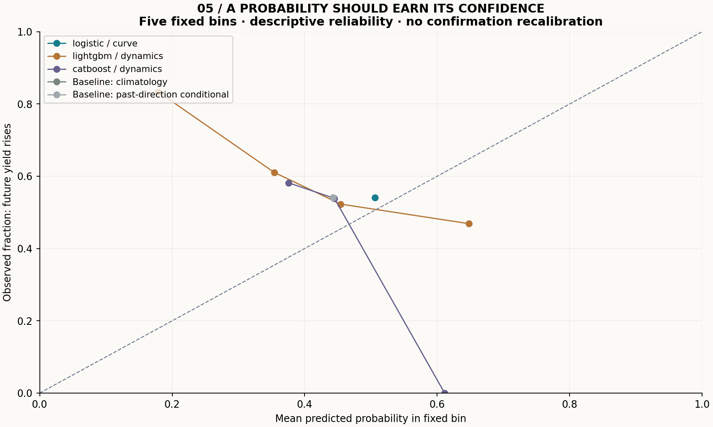
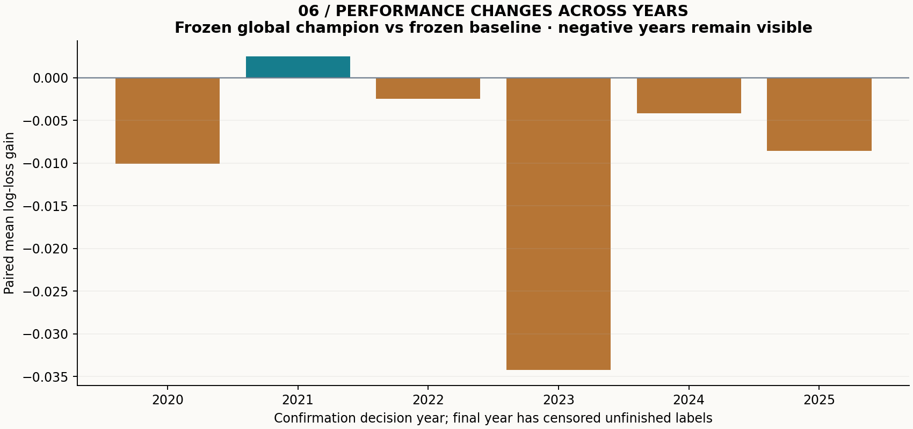

# Treasury yield-direction classification: real public data

**Data:** 9,005 official H.15 Treasury yield observations, 1990–2025; public-domain Board reuse policy, with attribution. Current historical vintage, retrieved in October 2026. **Task:** predict whether the 10-year constant-maturity yield rises over twenty observation sessions beginning on the future decision day. This is a yield-reference classification study, not bond-price or trading-return research.

## Main finding

The development-selected classifier is **catboost/dynamics**; the development-selected baseline is **training_climatology**. The overall development leader, including baselines, is **training_climatology**: calling a configuration the best classifier does not mean it earned promotion over a simpler baseline. On 1,479 confirmation decision dates (2020-01-02 to 2025-12-01), the selected classifier's mean paired log-loss gain is **-0.00951**, with a 63-session block 95% interval **[-0.01688, -0.00297]**. Positive gain favors the classifier. The interval lies below zero: the frozen classifier is worse than the baseline on log loss in this historical confirmation. Accuracy uncertainty and the other model comparisons remain visible; this does not prove universal model inferiority.

## Know what was available

Observation t supplies five yield levels and strictly trailing features. A full intervening observation session is allowed for H.15 publication; features are assumed available after that session, and the decision is at 09:00 New York time on t+2. The label starts with the later measurement on t+2 and ends twenty observed sessions afterward. The old feature-date yield is not the label's starting point. Both label endpoints are excluded from features. Label availability includes the same subsequent publication allowance.

Training labels must be complete and available strictly before a validation decision. All development-selection labels must also be available before 1 January 2020; late-2019 targets reaching confirmation are excluded. See `fold_audit.csv`, `audit.json` and all 8,732 timed rows in `sample_clocks.csv`. No price/rate is forward-filled. A month is twenty supplied observations, not twenty calendar days.

Exact historical release clocks and revision vintages are unavailable. The current H.15 schedule supports a conservative timing assumption, not a reconstructed historical release archive. Historical familiarity and revisions mean these are chronological historical checks, not genuinely unseen prospective OOS evidence. Treasury changed its curve methodology on 6 December 2021; old and new official measurements remain in the realized series rather than a constant-methodology backfill.

## Development, selection and probability quality

Three expanding validation windows (2008–2011, 2012–2015 and 2016–2019) compare logistic regression, LightGBM and CatBoost across curve, dynamics and combined features. Hyperparameters, 0.50 threshold and feature definitions are fixed. Every training fold fits its own imputer and scaler. A climatology baseline and a past-direction-conditioned baseline use only eligible training labels, with Laplace smoothing. Selection minimizes pooled development log loss, with deterministic name tie-breaking; it does not maximize confirmation accuracy. No early stopping, threshold search or confirmation recalibration occurs.

One representative per model family, the global champion and the best of two baselines were persisted in `frozen_selection.json` before confirmation metrics. All three family representatives and both baselines are reported below; a different confirmation ranking does not replace the frozen champion. All nine development candidates and fold scores remain in the CSVs.

|Frozen configuration|Accuracy|Balanced accuracy|Log loss ↓|Brier ↓|ROC AUC|
|---|---:|---:|---:|---:|---:|
|logistic / curve|52.54%|52.46%|0.68488|0.24589|0.569|
|lightgbm / dynamics|46.72%|49.86%|0.73373|0.26931|0.434|
|catboost / dynamics|45.03%|48.91%|0.71866|0.26257|0.429|
|Baseline: climatology|45.91%|50.00%|0.70915|0.25796|0.500|
|Baseline: past-direction conditional|45.91%|50.00%|0.70887|0.25782|0.557|

## Dependence and uncertainty

Twenty-session labels overlap. Purging prevents unavailable training outcomes from entering fitting or selection; it does not make test rows independent. Paired non-circular moving blocks of 63 and 126 sessions, with 2,000 resamples and seed 20261024, preserve local serial dependence in losses. Intervals are descriptive, conditional on the development freeze, and rely on approximate stationarity. They do not account for the entire history of financial model discovery or create 1,000 independent monthly forecasts from daily rows. The every-twentieth-anchor diagnostic reduces label-window overlap without claiming independent observations.

|Frozen family representative|Block sessions|Mean paired log-loss gain|95% interval|Contains zero?|
|---|---:|---:|---:|---|
|logistic / curve|63|0.02427|[-0.00200, 0.05860]|yes|
|logistic / curve|126|0.02427|[0.00131, 0.06545]|no|
|lightgbm / dynamics|63|-0.02458|[-0.03842, -0.00852]|no|
|lightgbm / dynamics|126|-0.02458|[-0.03768, -0.00802]|no|
|catboost / dynamics|63|-0.00951|[-0.01688, -0.00297]|no|
|catboost / dynamics|126|-0.00951|[-0.01691, -0.00269]|no|

The following fixed-bin reliability diagram checks confidence rather than only sign accuracy. Bins are predefined at width 0.2; empty bins remain in the CSV. No calibration transformation is fitted to confirmation outcomes.

## Stress, artifacts and limitations

A four-session availability stress holds the base champion's model and feature variant fixed, rebuilds clocks, purges/refits only before confirmation and reports both baselines. Its paired log-loss gain is -0.00294, 63-session interval [-0.01020, 0.00380]. Base and stress predictions are aligned on identical decision dates and target endpoints; the longer delay makes the feature observation older. The observation-key ROW_ID therefore changes while the decision-date outcome remains the same. This is a robustness diagnostic, not a new model-selection stage. Annual, as-of curve-inversion and reduced-overlap diagnostics are retained without reselection.

The output contains ranking, fold audits/scores, frozen choice, keyed confirmation probabilities, sample clocks, six figures, fixed-bin reliability, year/group slices and availability-stress predictions. `manifest.json` binds data, source, protocol, environment and every generated file. Runtime and sampled RSS cover model comparisons, inference and stress, excluding plotting and file writing after the timed block. See [data rights](../../DATA_LICENSE.md), [methods](../../docs/METHODS.md), [walkthrough](../../docs/WALKTHROUGH.md) and [validation](../../docs/VALIDATION.md).

Reference yields are interpolated indicative measures. No bond maturity roll, duration/convexity, coupons, financing, execution or transaction costs are modeled; accuracy or AUC cannot be translated into trading return or Sharpe. Original course, employer and challenge data remain outside this independently implemented study. Negative and insignificant outcomes are retained. Development and documentation were AI-assisted.
